# MezoFlow

**Put your MUSD to work.** MezoFlow is a money manager for MUSD, Mezo's Bitcoin-backed dollar. You can save it in vaults, send it into Mezo's Stability Pool to earn BTC from liquidations, split one deposit across several strategies, or swap BTC straight into a strategy. Each of these takes one signature and one transaction.

Everything runs on Mezo Testnet. The app reads every number from deployed contracts. There is no backend database.

- **Live app:** https://mezoflow.vercel.app
- **Demo video (4 min, narrated, real testnet transactions):** [docs/demo/mezoflow-demo.mp4](https://github.com/snenu/MezoFlow/blob/main/docs/demo/mezoflow-demo.mp4)
- **Contracts:** 11, all verified on the [Mezo explorer](https://explorer.test.mezo.org/address/0x548D3c642e39593c7D31F3C678878a3dB859F5dd?tab=contract)
- **Health check:** https://mezoflow.vercel.app/api/health

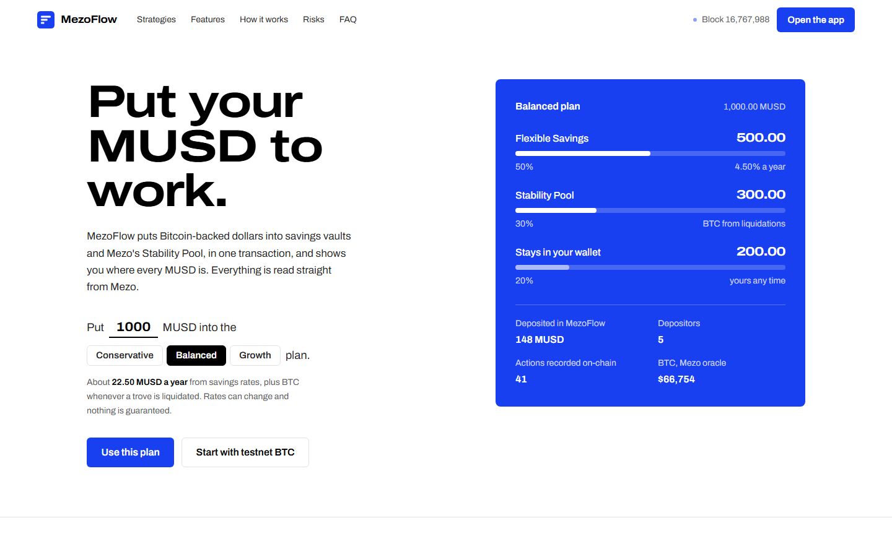

## Try it in two minutes

1. **Get testnet BTC.** Paste your address at [faucet.test.mezo.org](https://faucet.test.mezo.org). Gas on Mezo is paid in BTC and costs a fraction of a cent.
2. **Open [mezoflow.vercel.app/app/swap](https://mezoflow.vercel.app/app/swap) and connect.** Use MetaMask or any browser wallet. The app switches you to Mezo Testnet (chain 31611).
3. **Swap BTC into a plan.** Enter `0.0005` BTC, choose **Balanced plan**, then click **Swap and allocate**. You sign one BTC permit and send one transaction. MezoFlow swaps through Mezo Pools and splits the MUSD across Flexible Savings and the Stability Pool, leaving 20% in your wallet.
4. **See it land.** **Overview** shows your positions and where every MUSD sits. **Activity** lists the action with a link to the explorer. **Risk** shows Mezo's live oracle price and its weakest trove.
5. **Take some back.** Open **Strategies → Flexible Savings → Withdraw**. There is no fee and no wait.

If you have no BTC, click **Get 10 test MUSD** in the sidebar. It claims from MezoFlow's on-chain faucet, once per address per day. Without a wallet you can still browse every page in read-only mode.

## How MezoFlow uses Mezo

| Mezo piece | How MezoFlow uses it |
|---|---|
| **MUSD** | The unit of account everywhere. All three vaults are ERC-4626 vaults over real testnet MUSD (`0x1189…c503`). Every balance, rate, fee and portfolio figure is in MUSD. |
| **MUSD permit (EIP-2612)** | Deposits, allocations and reserve top-ups use `…WithPermit` functions. The user signs a permit, and the deposit happens in the same transaction, with no separate approval. |
| **BTC and MEZO token permits** | Mezo's BTC and MEZO precompile tokens support EIP-2612. MezoFlow derived their permit domains from `DOMAIN_SEPARATOR`, so a swap pulls BTC with a signature instead of an approval. |
| **Mezo Pools** | `MezoFlowZap` quotes and swaps BTC or MEZO to MUSD through Mezo's Pools router (`0x9a1f…D7E9`), with Mezo's own pool factory pinned. It then deposits into a vault or a preset plan in the same transaction. The app shows the pool price next to Mezo's oracle price. |
| **Stability Pool** | `StabilityPoolVault` deposits into Mezo's official MUSD Stability Pool, collects BTC from liquidations and shares it pro rata. It keeps a 10% idle buffer and respects Mezo's rule that blocks pool withdrawals while any trove is under 110% collateral. |
| **PriceFeed, TroveManager, SortedTroves** | The risk dashboard, alerts and Ask Flow read Mezo's BTC oracle, total collateral ratio, weakest trove and pool size live. They warn when withdrawals could pause. |
| **Mezo Testnet** | All contracts are compiled for Mezo's `london` EVM target, verified on Blockscout, and use BTC for gas. Deposits, exits and swaps are written to an on-chain activity ledger. |

## Features

| Feature | What you get |
|---|---|
| **Flexible Savings** | Withdraw any time with no fee. Earns 4.50% APR, paid from a visible on-chain reward reserve. |
| **Term Savings** | 8.00% APR for a 7-day lock. Leaving early costs 1.5%, which goes back to the reserve for the holders who stay. Your penalty is fixed when you deposit and can never be raised. |
| **Stability Pool** | Earns BTC when troves are liquidated. 0.10% exit fee. The page shows whether withdrawals are open right now. |
| **Get MUSD** | Swap BTC or MEZO to MUSD and send it to your wallet, a strategy or a preset plan, in one transaction. |
| **Auto allocator** | Conservative, Balanced and Growth plans, stored on-chain, or a custom split. Move an existing position to another plan in one step using vault-share permits. |
| **Overview** | Portfolio value over time, rebuilt from the ledger and share-price checkpoints. Shows where every MUSD sits, your lifetime totals and your claimable BTC. |
| **Risk dashboard** | Live Mezo health, whether pool withdrawals are open, how long each reserve lasts, and your exposure weighted by risk. A loss calculator for the Stability Pool. |
| **Activity** | Every action from the on-chain `ActivityLedger`, with explorer links and CSV export. You can switch between your own activity and everyone's. |
| **Alerts** | Preferences saved on-chain in `AlertCenter`. Alerts come from ledger events, rate changes, announcements and live pool health. |
| **Ask Flow** | Plain-English answers about strategies, risks and your positions, using read-only chain tools. It can never move funds. It uses an AI model through Vercel AI Gateway when the project has credits. Otherwise, as on the live site today, a built-in guide answers from the same chain data. |
| **Test MUSD faucet** | 10 MUSD per address per day, for people without testnet BTC. |
| **Clear feedback** | Every transaction shows its steps, a pending toast, then a confirmation with an explorer link. Contract errors are translated into plain English. |

## Screenshots

| Overview | Get MUSD (Mezo Pools) |
|---|---|
| 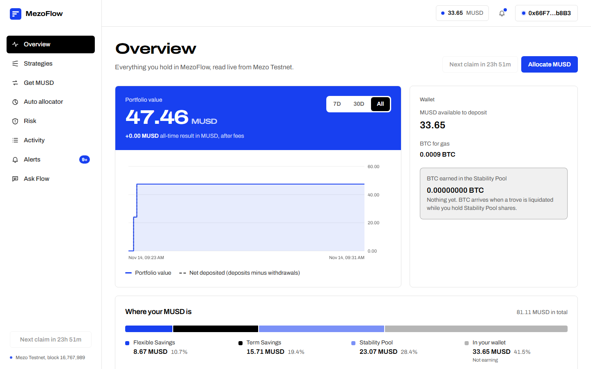 | 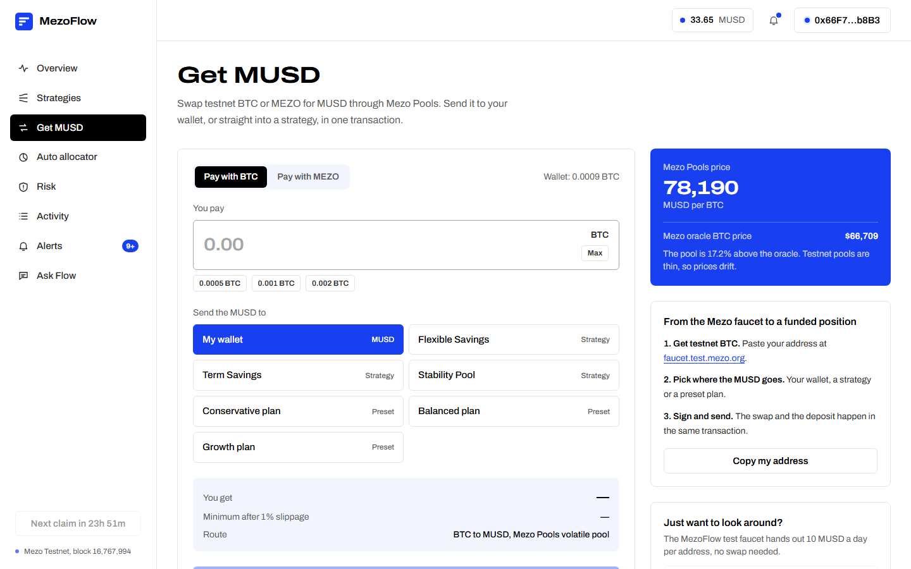 |
| **Auto allocator** | **Risk dashboard** |
| 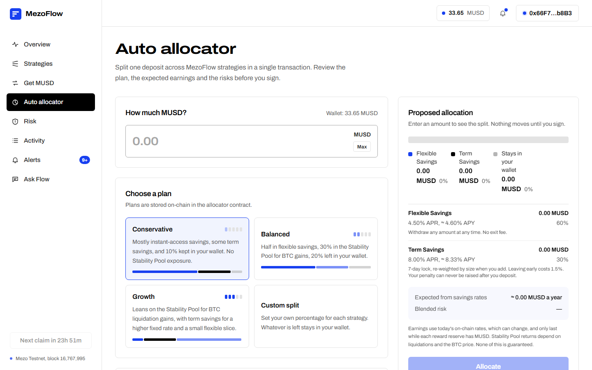 | 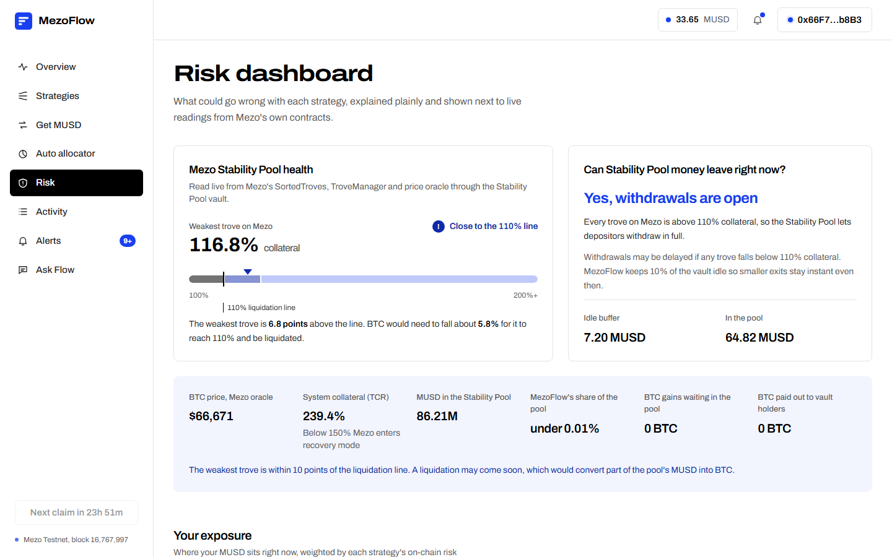 |
| **Strategies** | **Activity ledger** |
| 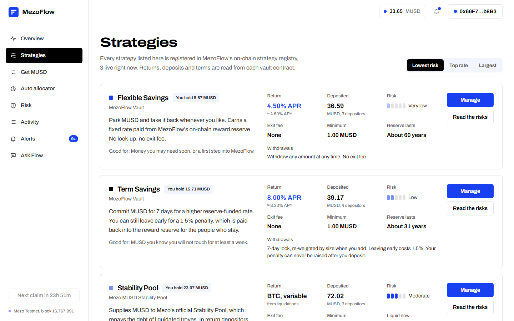 | 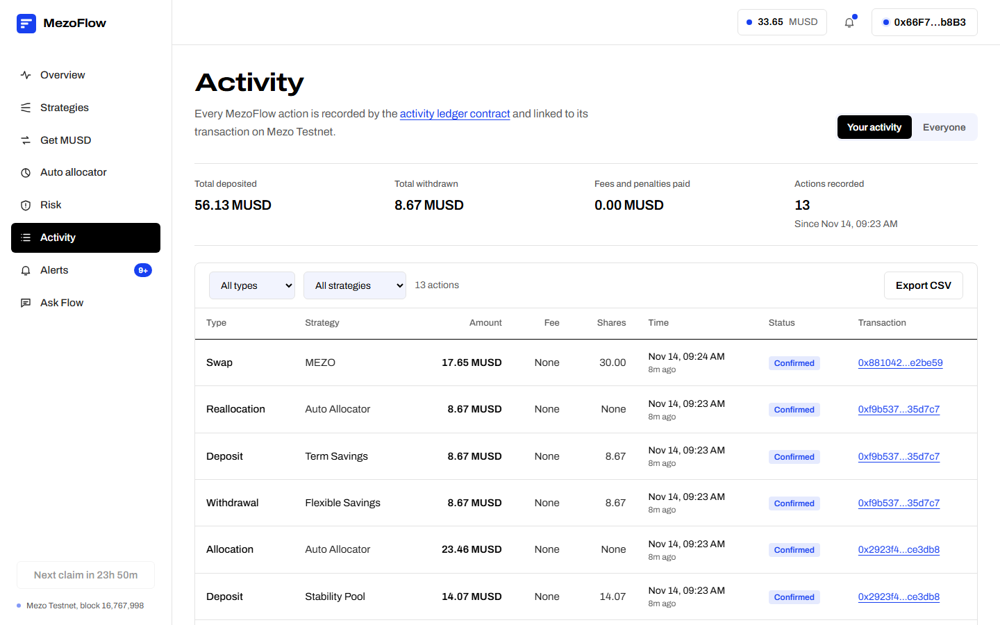 |

On phones and tablets, every route was checked at 360–414 px and 820 px with no horizontal scroll:

| Phone: overview | Phone: Get MUSD | Phone: Stability Pool | Tablet: risk |
|---|---|---|---|
| 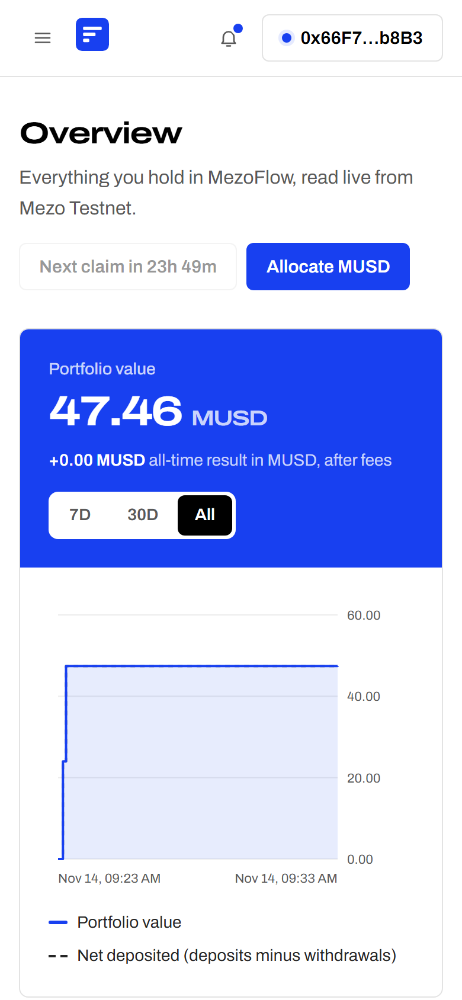 | 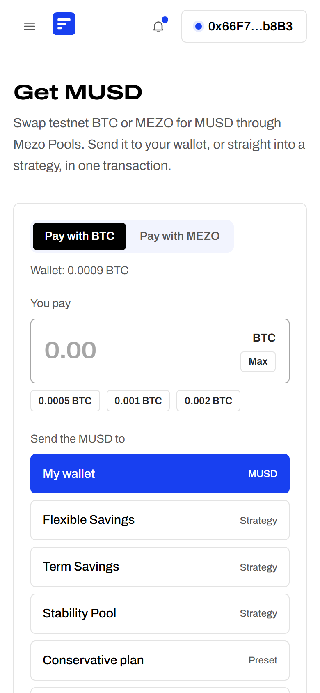 | 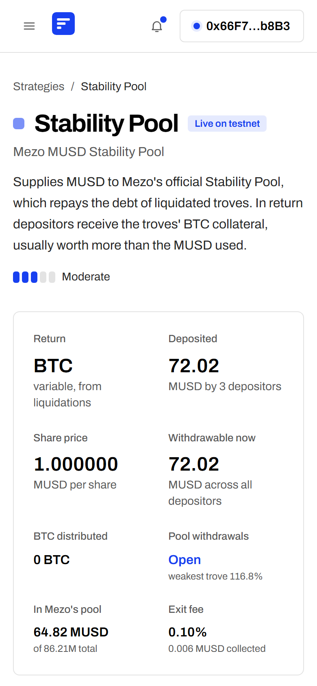 | 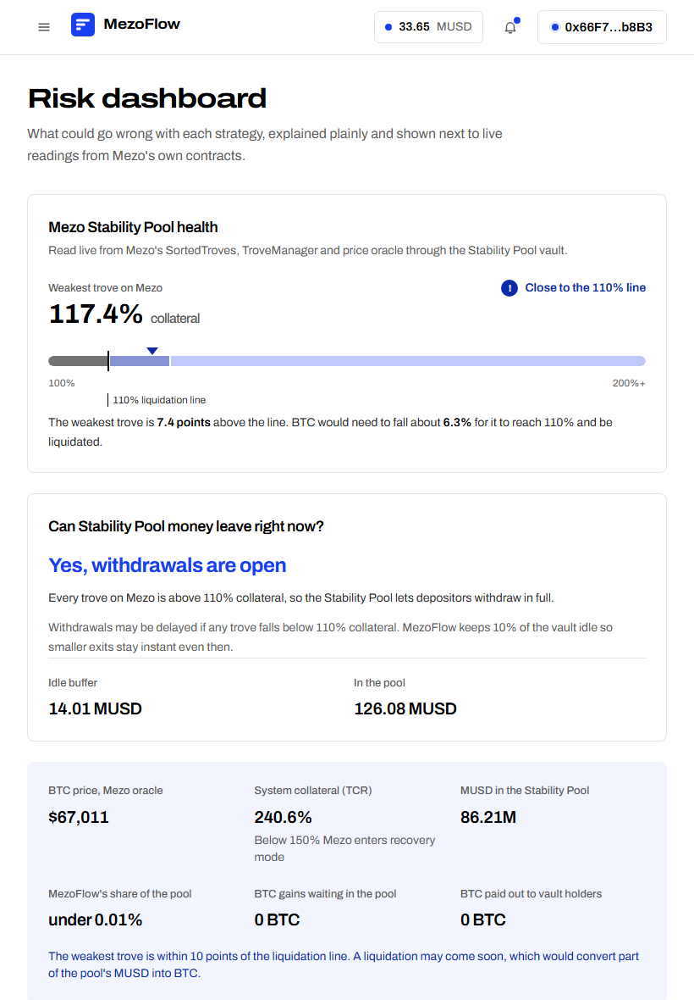 |

More screenshots are in [docs/screenshots](docs/screenshots).

## Architecture

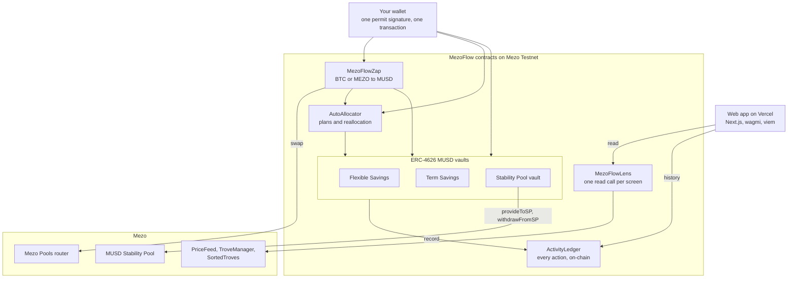

- **Supporting contracts.** `StrategyRegistry` lists the strategies and announcements, `FeeManager` holds the exit-fee schedule, `AlertCenter` stores alert preferences, and `MUSDFaucet` hands out test MUSD. MUSD, BTC and MEZO are pulled with EIP-2612 permits.
- **No backend state.** The two serverless routes are `/api/health`, which reads the RPC and the Lens contract, and `/api/assistant`, which answers questions using read-only chain tools. Neither stores anything.
- **One read call per screen.** `MezoFlowLens` returns protocol, strategy and account data, plus permit nonces, in a single call, batched through Multicall3.
- **History from the chain.** The activity page, CSV export, portfolio chart and alerts are all rebuilt from `ActivityLedger` entries and events.

## Contracts (Mezo Testnet, chain 31611)

All 11 are verified on Blockscout. Addresses and constructor arguments are in [`deployments/mezotestnet.json`](deployments/mezotestnet.json); every deployment and setup transaction is in [`deployments/deploy-log.json`](deployments/deploy-log.json).

| Contract | What it does | Address |
|---|---|---|
| FlexibleSavingsVault | ERC-4626 MUSD vault, withdraw any time | [0x914b…2F84](https://explorer.test.mezo.org/address/0x914bCE915DFaE6Bdd9d6773829E82909F36a2F84?tab=contract) |
| TermVault | ERC-4626 MUSD vault, 7-day lock, higher rate | [0x2EeB…F844](https://explorer.test.mezo.org/address/0x2EeBD6785AB282A07b20A4b1DdF73B126662F844?tab=contract) |
| StabilityPoolVault | ERC-4626 vault over Mezo's Stability Pool, pays BTC gains | [0xB57e…2fA3](https://explorer.test.mezo.org/address/0xB57e3573E5eadF4468972B043C1E164d16aB2fA3?tab=contract) |
| MezoFlowZap | Swaps BTC or MEZO to MUSD through Mezo Pools, then deposits or allocates in one transaction | [0xebB3…Bfc3](https://explorer.test.mezo.org/address/0xebB377E8519d5B5125C33E31231cEbC3BB73Bfc3?tab=contract) |
| AutoAllocator | Splits one deposit across vaults; presets; reallocation | [0xf3DD…B82B](https://explorer.test.mezo.org/address/0xf3DD9838269aFf50a5E702b71Da60ad5fE92B82B?tab=contract) |
| ActivityLedger | Every user action, on-chain | [0x8aE2…Bd4a](https://explorer.test.mezo.org/address/0x8aE22979669d93B106304700B27657Fe2814Bd4a?tab=contract) |
| StrategyRegistry | Strategy catalogue and protocol announcements | [0xE496…9C0D](https://explorer.test.mezo.org/address/0xE496A7b6eA9D33f967d654428a23c906ed7D9C0D?tab=contract) |
| FeeManager | Exit fees and treasury; fee increases wait 2 days | [0x836D…a9e2](https://explorer.test.mezo.org/address/0x836D0c8e9aAaF425e892c0c76A93e058C17Da9e2?tab=contract) |
| AlertCenter | Alert preferences, stored on-chain | [0xE25A…93cF](https://explorer.test.mezo.org/address/0xE25AC0100B76d154d44B1883CA15a2aAe90793cF?tab=contract) |
| MUSDFaucet | 10 test MUSD per address per day | [0x2175…Cb56](https://explorer.test.mezo.org/address/0x217522c6C7d434E96034484e5f38c71a0747Cb56?tab=contract) |
| MezoFlowLens | Batched read API used by the app | [0x548D…F5dd](https://explorer.test.mezo.org/address/0x548D3c642e39593c7D31F3C678878a3dB859F5dd?tab=contract) |

Mezo contracts used: [MUSD](https://explorer.test.mezo.org/address/0x118917a40FAF1CD7a13dB0Ef56C86De7973Ac503), [Stability Pool](https://explorer.test.mezo.org/address/0x1CCA7E410eE41739792eA0A24e00349Dd247680e), [Pools router](https://explorer.test.mezo.org/address/0x9a1ff7FE3a0F69959A3fBa1F1e5ee18e1A9CD7E9), [PriceFeed](https://explorer.test.mezo.org/address/0x86bCF0841622a5dAC14A313a15f96A95421b9366), [TroveManager](https://explorer.test.mezo.org/address/0xE47c80e8c23f6B4A1aE41c34837a0599D5D16bb0), [SortedTroves](https://explorer.test.mezo.org/address/0x722E4D24FD6Ff8b0AC679450F3D91294607268fA), and the BTC and MEZO tokens.

## Proof it works: real transactions

**Browser end-to-end test on the live site.** [`e2e/e2e.mjs`](e2e/e2e.mjs) drives https://mezoflow.vercel.app in Chromium with a fresh testnet wallet, clicking through the real UI. Each transaction must be sent by the wallet, succeed on-chain, show its success toast, and then be confirmed through the Blockscout API. Final run: **20 checks passed, 0 failed, 11 transactions, 0 page errors** ([`deployments/e2e-browser-production.json`](deployments/e2e-browser-production.json)).

| # | Action in the UI | Transaction |
|---|---|---|
| 1 | Swap 0.0003 BTC to MUSD in the wallet (BTC permit, Mezo Pools) | [0x766c5115…](https://explorer.test.mezo.org/tx/0x766c5115710a43edc201e71591bf8508e36a3b858afdd4443dfef86f816521e8) |
| 2 | Swap 0.0002 BTC and deposit into Flexible Savings, one transaction | [0x8cd7992f…](https://explorer.test.mezo.org/tx/0x8cd7992f7d075e3c5f98ed575d0d0eaeede24071640c801985d53a814716d01e) |
| 3 | Claim test MUSD from the MezoFlow faucet | [0x7a4a1d37…](https://explorer.test.mezo.org/tx/0x7a4a1d37600a348e9031278c92670f917d6e7cedf82b034049e79a292fda8c19) |
| 4 | Deposit 3 MUSD into Term Savings (MUSD permit) | [0xa576a8f0…](https://explorer.test.mezo.org/tx/0xa576a8f0f1cc0b775c5b8a1a40ccfcf0127f38e4222b1e980675b3af23d3594f) |
| 5 | Deposit 3 MUSD into the Stability Pool vault (permit) | [0x580f59ab…](https://explorer.test.mezo.org/tx/0x580f59abe10e9e6ba5c4d00c265bbb64e8319f0de9b3102a0f8071c555d3c42c) |
| 6 | Withdraw 1 MUSD from the Stability Pool vault | [0xec1fe039…](https://explorer.test.mezo.org/tx/0xec1fe039cfa0c87c61ec6d7a81d44dbed2baeb4b2fbe51a6460c30daa4e740e1) |
| 7 | Withdraw 1 MUSD from Flexible Savings | [0x40957bbf…](https://explorer.test.mezo.org/tx/0x40957bbf66bd66cff585578fc7a16b1d9fc311292c000266902cd47047cbfb8b) |
| 8 | Allocate 12 MUSD with the Growth plan (permit) | [0xc6e0facd…](https://explorer.test.mezo.org/tx/0xc6e0facd9394522fd062713ad7e375260f7b97a9092bd7201b4050b9ecb99e6d) |
| 9 | Move the Flexible Savings position to the Balanced plan (share permit) | [0x602fbc79…](https://explorer.test.mezo.org/tx/0x602fbc79de03be06b1b6380b52a9275851e7617f2639b04332de120c2ddc11ea) |
| 10 | Leave Term Savings early (1.5% penalty to the reserve) | [0x844f15fa…](https://explorer.test.mezo.org/tx/0x844f15fa18ae99cd11cff812d61eb9f35a996a94b2454c0070a6fdaef2266a65) |
| 11 | Save alert preferences on-chain | [0xb87394a5…](https://explorer.test.mezo.org/tx/0xb87394a5c1a40dda64a1bb4db94ff80118eb72d5d961449c2c61df84602ad6a9) |

The run also checks the activity labels, CSV export, risk telemetry, Ask Flow, the overview, and no horizontal scroll at 375 px and 820 px on 10 routes.

**Seeded demo data.** [`contracts/scripts/seed-e2e.js`](contracts/scripts/seed-e2e.js) funded three fresh wallets from the deployer and ran every contract path. All 28 transactions are in [`deployments/e2e-seed.json`](deployments/e2e-seed.json). Highlights:

| Wallet | Action | Transaction |
|---|---|---|
| Ana | Deposit 25 MUSD into Flexible Savings (permit, 1 tx) | [0x69ab6c28…](https://explorer.test.mezo.org/tx/0x69ab6c28b53da7398be75811d133c393f9742b00206283c5ba20c96f3f120cd5) |
| Ana | Swap 0.0003 BTC and deposit into Term Savings | [0xd57a78ae…](https://explorer.test.mezo.org/tx/0xd57a78ae3c529bf75c56080d6080d610f78723c62674c2cbafaa65651a8537e7) |
| Ben | Allocate 30 MUSD with the Balanced plan (permit) | [0xfae955e4…](https://explorer.test.mezo.org/tx/0xfae955e44b54e1b36951dc5c210ce3d9c828cd659e590477f45e020643557499) |
| Ben | Swap BTC straight into the Growth plan | [0x2923f420…](https://explorer.test.mezo.org/tx/0x2923f420385971966ad83abd6ae426eff72707949672aeea6a8f033e5dce3db8) |
| Ben | Move half his Flexible shares to Term (share permit) | [0xf9b537fd…](https://explorer.test.mezo.org/tx/0xf9b537fdb1bbc2bd6da5af525f7933a830c348068b68f3ba1ee4aba1e835d7c7) |
| Ben | Swap 30 MEZO to MUSD (MEZO permit) | [0x881042f9…](https://explorer.test.mezo.org/tx/0x881042f9f37d35d8fc8b4db6acbc2d807472994daa1b895813c7564084e2be59) |
| Chloe | Deposit 40 MUSD into the Stability Pool vault (permit) | [0x13bc0ede…](https://explorer.test.mezo.org/tx/0x13bc0edeef585e5b28bffa78ecba7b615abbd29a51a8e628b89cb7441cd7197d) |
| Chloe | Leave Term early (1.5% penalty to the reserve) | [0xb7c14f0a…](https://explorer.test.mezo.org/tx/0xb7c14f0ae28d6c7ad75ec65e86e288a2fe9c153553675ab8dcc0737436ee4de2) |
| Keeper | Rebalance the Stability Pool vault | [0x527f73cb…](https://explorer.test.mezo.org/tx/0x527f73cb0fdc35b6e5dad91712b71e8d9243834143f5b56dbd410705e4e70621) |

**Demo video.** The six transactions made on camera are listed in [`deployments/demo-video-txs.json`](deployments/demo-video-txs.json): `swapWithPermit`, `swapAndDepositWithPermit`, `depositWithPermit`, `allocatePresetWithPermit`, `withdraw` and `setPreferences`. All six were confirmed on the explorer.

## Security

The full write-up is in [`docs/SECURITY.md`](docs/SECURITY.md). It is an internal review, not a third-party audit.

- **Method.** Every external function, state transition and money path was reviewed. Each issue got a failing proof-of-concept test first, then a fix, and the test was kept as a regression test. The failing output from before the fixes is saved in [`docs/audit/`](docs/audit).
- **Findings.** 11 in total: 6 medium, 4 low and 1 informational, **all fixed**. Examples:
  - A stranger could extend your Term lock.
  - A direct MUSD transfer could inflate the share price.
  - `reallocate` trusted any address.
  - The owner could front-run exits with fee or penalty increases.
  - Transferring vault shares moved the sender's earned BTC to the recipient.
  - Dust left by the last holder skewed the next depositor's share price. This one was found by the browser e2e.
- **Tests.** **50 passing:**
  - 21 behaviour tests;
  - 11 audit regressions;
  - 18 tests for permits, the zap and accounting, including a seeded 120-step invariant fuzz.
- **Owner limits.** The owner can never touch depositor principal. Rates are capped at 20% APR, exit fees at 2% (raises wait 2 days), and the Term penalty at 5%, never above your deposit-time snapshot. Withdrawals can't be paused.

## Run it locally

```bash
# Contracts: tests
cd contracts && npm install
npx hardhat test                                   # 50 passing

# Full local stack: a Hardhat node shaped like Mezo Testnet (mock MUSD, BTC/MEZO
# permit tokens, Mezo Pools router and Stability Pool), plus the whole suite
LOCAL_MEZO=1 npx hardhat node                      # terminal 1
LOCAL_MEZO=1 npx hardhat run scripts/deploy-local.js --network localhost
DEPLOYMENT=local node scripts/export-web.js        # writes web/src/lib/generated.ts

# Web app (set NEXT_PUBLIC_MEZO_RPC=http://127.0.0.1:8545 in web/.env.development.local)
cd ../web && npm install && npm run dev

# Mezo Testnet: put PRIVATE_KEY in contracts/.env (gitignored), then
npx hardhat run scripts/deploy.js   --network mezotestnet
npx hardhat run scripts/verify.js   --network mezotestnet
npx hardhat run scripts/seed-e2e.js --network mezotestnet
node scripts/export-web.js

# Browser e2e and the narrated demo (Playwright; keys come from contracts/.env.wallets)
cd ../e2e && npm install && npx playwright install chromium
node e2e.mjs            # against https://mezoflow.vercel.app by default
node video.mjs          # needs ffmpeg and python -m pip install edge-tts
```

**Repository layout**

| Folder | Contents |
|---|---|
| `contracts/` | Hardhat project: contracts, tests and scripts for deploy, verify, seed and local stack. |
| `web/` | Next.js 16 app: wagmi, viem, Tailwind 4, AI SDK. |
| `e2e/` | Playwright browser tests with an injected EIP-6963 test wallet, the screenshot tool and the demo recorder. |
| `deployments/` | Addresses, constructor arguments and every transaction hash. |
| `docs/` | Security review, audit evidence, screenshots and the demo video. |

## Notes from building on Mezo

- **OpenZeppelin version.** OpenZeppelin 5.2+ emits the Cancun `mcopy` opcode, which Mezo's `london` target doesn't support. The contracts pin OpenZeppelin 5.1.0.
- **Permit domains for BTC and MEZO.** Mezo's BTC and MEZO tokens support EIP-2612 but have no `eip712Domain()`. The domains (`"BTC"`/`"MEZO"`, version `"1"`) were recovered by matching `DOMAIN_SEPARATOR`.
- **Gas estimates.** `eth_estimateGas` underestimates calls that make nested external calls (permit, then swap, then deposit). The app pads estimates with a per-function floor. Gas costs about 150 wei, so the padding is free.
- **Log queries.** `eth_getLogs` is capped at 10,000 blocks. The ledger stores block numbers, so the app only queries the windows it needs.

## Roadmap

- **Mainnet.** Third-party audit; owner powers behind a multisig and timelock; keeper automation for `poke` and `rebalance`.
- **Mezo Passport.** Wallet connection for Bitcoin wallets alongside EVM wallets.
- **More strategies.** An MUSD/BTC liquidity vault on Mezo Pools, and a "borrow to save" route that opens a Mezo trove and deposits the MUSD in one flow.
- **Delivery.** Alerts by email or push, using the on-chain preferences that already exist.
- **Ask Flow.** Model answers by default once AI Gateway credits are added.

---

Testnet only. The vaults hold test funds. Rates are paid from on-chain reserves and can change; nothing here is a promise of returns.
